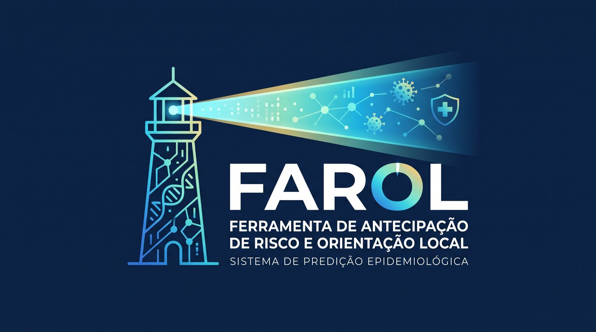
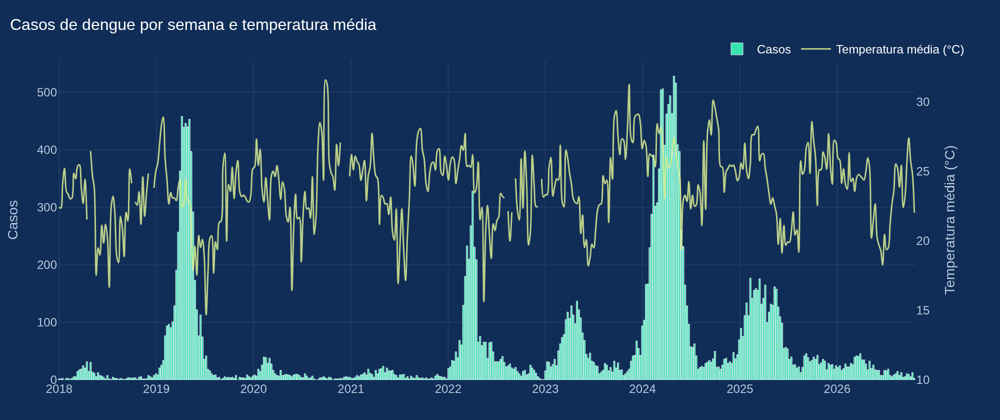
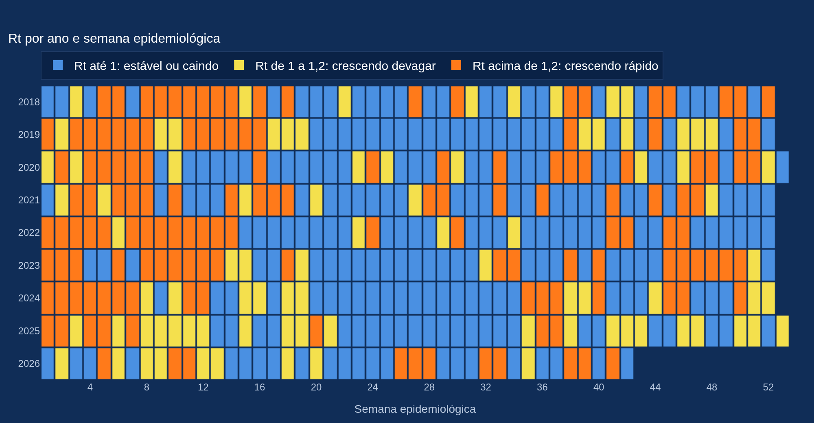

# FAROL · Vigilância da Dengue

**F**erramenta de **A**ntecipação de **R**isco e **O**rientação **L**ocal

*A dengue precisa ser combatida antes do pico, não depois.*

**[🌐 Site](https://2rteksolutions.github.io/vigilancia-dengue/) · [🧪 Simulador](https://2rteksolutions.github.io/vigilancia-dengue/simulador.html) · [📊 Painel](https://farol-dengue.streamlit.app/)**

🥉 **3º lugar na Feira de Tecnologia da Fatec Olímpia (outubro de 2026)**

---

## 🔦 Sobre

O FAROL organiza os dados públicos da dengue para a vigilância epidemiológica de municípios pequenos e médios: mostra como está a semana, antecipa as semanas de maior risco e ajuda o controle de vetores a decidir onde agir primeiro.

Começou como projeto de extensão do curso de Desenvolvimento de Software Multiplataforma (DSM) da **Fatec Olímpia** e está sendo desenvolvido como produto pela **[2RTek Solutions](https://www.2rteksolutions.com.br)**.

| | Pergunta | O que o FAROL entrega |
| :---: | --- | --- |
| 📈 | **Como estamos?** | Casos, nível de alerta e Rt por semana |
| 🔮 | **O que vem aí?** | Previsão das semanas de maior risco, com histórico, Rt e clima |
| 📍 | **Onde agir primeiro?** | Fila e mapa de ações para o controle de vetores |

> [!NOTE]
> O [simulador](https://2rteksolutions.github.io/vigilancia-dengue/simulador.html) é uma demonstração com Olímpia/SP, Itanhaém/SP e Viçosa/MG. Casos e clima são reais (InfoDengue); previsão, denúncias e mapa são simulados.

## 📊 Um pouco do painel

## 👥 Equipe

<table>
  <tr>
    <td align="center">
      <a href="https://github.com/duartelab"> <b>Raquel Duarte</b></a>
    </td>
    <td align="center">
      <a href="https://github.com/ReCroffi"> <b>Renan Croffi</b></a>
    </td>
  </tr>
</table>

## 🔒 Código-fonte

Este repositório publica só o site de apresentação. O código do FAROL (coleta e tratamento dos dados, modelo de previsão, banco e painel) é privado.

Quer conhecer o projeto ou levar o FAROL para o seu município? Fale com a gente pelo site da [2RTek Solutions](https://www.2rteksolutions.com.br).

---

  © 2026 Raquel Duarte e Renan Croffi · Todos os direitos reservados · <a href="LICENSE">Licença</a>

